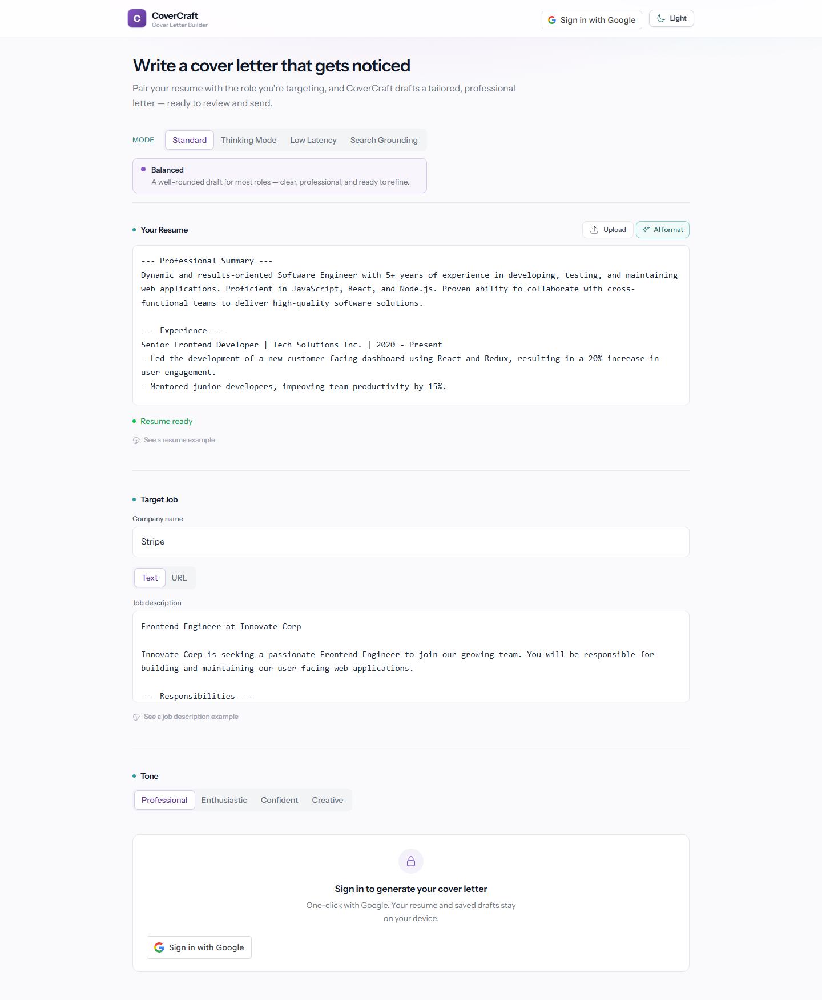

<div align="center">
  

  <sub><a href="docs/assets/covercraft-home-dark.png">Dark mode screenshot</a></sub>
</div>

# CoverCraft

**Resume + job posting → a tailored cover letter, in the tone you pick.**

[Live demo](https://coverltr.vercel.app/) · [Issues](https://github.com/abustark/cover_letter_gen/issues) · [Project facts](PROJECT-INFO.md)

CoverCraft turns two unstructured documents — a resume (PDF or DOCX) and a job description (pasted text or a posting URL) — into a job-specific cover letter you can review, copy, export as PDF/DOCX, or save as a draft.

---

## Features

| | |
|---|---|
| **Four generation modes** | Balanced, Thinking (deep reasoning for senior roles), Low Latency, From URL (reads the posting from a link) |
| **Four tones** | Professional, Enthusiastic, Confident, Creative — enforced in server-controlled prompts |
| **Server-side security boundary** | Google ID tokens verified cryptographically server-side for all API endpoints; API keys never ship to browser |
| **SSRF-hardened URL reader** | HTTPS enforcement, private/cloud-metadata IP blocking, DNS resolution, bounded manual redirects, streaming byte cap |
| **Strict AI contract** | Model allowlist, input size caps, prompt-injection isolation via XML delimiters, anti-hallucination factual grounding |
| **Resume intake** | PDF (up to 10 pages) via `pdfjs-dist`, DOCX via `mammoth`, client-side parsing (no file uploads to server), scanned document detection |
| **User review checklist** | Interactive "Review before sending" checklist to verify role, claims, metrics, and tone before sending |
| **Rate limiting** | Sliding-window quotas by verified Google user `sub` and client IP address; Upstash Redis / Vercel KV adapter support |
| **Export suite** | One-click copy, PDF (`jsPDF`), DOCX (`docx`), local draft storage with quota recovery and schema migration |
| **Dark / light theme** | Persisted preference, View-Transition wave from toggle, CSS ripple fallback |
| **Automated testing & CI** | Suite covering token auth, SSRF defense, prompt architecture, file validation, and storage; GitHub Actions CI |

---

## Architecture

A hardened server security boundary with a rich, privacy-conscious client:

```
Browser (React SPA)
  ├── resume PDF/DOCX ──► pdfjs-dist / mammoth (client-side parse) ──► bounded text
  ├── job description ──► pasted text
  └── job posting URL ──► POST /api/fetch-url [Auth + SSRF + Rate Limit] ──► clean text (≤ 12k chars)
                                   │
                                   ▼
                POST /api/openrouter [Auth + Server Prompts + Rate Limit]
                                   │
                                   ▼
                      OpenRouter Chat Completions
                       (Model allowlist, temp 0.7)
                                   │
                                   ▼
              letter ──► checklist · copy · PDF · DOCX · draft (localStorage)
```

### Endpoints

| Method | Route | Purpose | Security & Guardrails |
|---|---|---|---|
| `POST` | `/api/openrouter` | Generates cover letters or formats resumes | Requires Google ID token via `Authorization: Bearer` · server verifies signature against Google JWKS · user & IP rate limits · server-owned system prompts with prompt-injection fences · model allowlist · 50 KB resume cap · 25 KB JD cap · pinned temp 0.7 · redacted error logs |
| `POST` | `/api/fetch-url` | Safely fetches & extracts job posting text | Requires Google ID token · user & IP rate limits · HTTPS-only · port 443 only · blocks localhost, private IPs, link-local, and cloud metadata (`169.254.169.254`) · DNS resolution checks · manual redirects (max 3) · 8s timeout · 2 MB stream cap · HTML text extraction (≤ 12k chars) |

### Model routing (server-enforced allowlist)

| Mode | Model ID | Purpose |
|---|---|---|
| Balanced (Standard) | `nvidia/nemotron-3-ultra-550b-a55b:free` | Frontier quality, 1M context |
| Deep reasoning (Thinking) | `nvidia/nemotron-3-super-120b-a12b:free` | Reasoning MoE for complex senior roles |
| Quick draft (Low Latency) | `google/gemma-4-26b-a4b-it:free` | Fast iteration MoE model |
| From URL | `nvidia/nemotron-3-ultra-550b-a55b:free` | Long context for extracted web pages |
| Resume formatting | `google/gemma-4-26b-a4b-it:free` | Fast structural cleanup utility |

---

## Stack

| Layer | Choice |
|---|---|
| UI | React 19, React DOM 19 |
| Build | Vite 6, `@vitejs/plugin-react` |
| Styling | Tailwind CSS v4 (`@tailwindcss/vite`) |
| Language | TypeScript 5.8 (`tsc --noEmit` gate) |
| AI Gateway | OpenRouter chat completions with server-side model allowlist |
| Auth | Google OAuth 2.0 (`@react-oauth/google`) with server-side cryptographic token verification |
| Parsing | `pdfjs-dist`, `mammoth` (lazy dynamic imports, client-side only) |
| Export | `jsPDF`, `docx` (lazy dynamic imports) |
| Testing | Automated test suite (`tsx --test`), GitHub Actions CI |
| Hosting | Vercel (`api/*.ts` serverless functions) / Vite dev server middleware |

---

## Getting started

**Prerequisites:** Node.js 18+ (Vite 6), a Google OAuth client ID, and an OpenRouter API key.

```bash
npm install
cp .env.example .env.local   # fill in OPENROUTER_API_KEY and VITE_GOOGLE_CLIENT_ID
npm run dev                  # http://localhost:3000
```

### Development Parity

In local development, `npm run dev` uses a Vite server middleware to execute the exact same `/api/openrouter` and `/api/fetch-url` handlers as Vercel serverless functions.
- The browser **never** receives `OPENROUTER_API_KEY` in development or production.
- URL fetching runs server-side in Node, preventing CORS failures when reading job postings.
- Google ID tokens are verified through the server middleware.

### Automated Testing

Run the automated test suite covering authentication, SSRF protection, prompts, drafts, and file validation:

```bash
npm test
```

To typecheck:

```bash
npm run typecheck
```

To build for production:

```bash
npm run build
```

---

## Security Model

**Server-enforced protections:**

- **Server Authentication Boundary:** All generation and URL-fetch endpoints require a Google ID token in the `Authorization: Bearer` header. The server verifies token signature against Google's public JWKS, verifies issuer (`accounts.google.com`), checks expiry with clock-skew tolerance, and matches audience against the configured client ID.
- **SSRF Defense:** The URL fetcher parses destination URLs with strict rules: HTTPS scheme only, no URL credentials, standard port 443 only. It resolves hostnames via DNS and blocks loopback (`127.0.0.0/8`, `::1`), private networks (`10.0.0.0/8`, `172.16.0.0/12`, `192.168.0.0/16`, `fc00::/7`), carrier-grade NAT (`100.64.0.0/10`), and cloud instance metadata services (`169.254.169.254`). Redirects are followed manually (max 3) and re-validated at each hop.
- **AI Proxy Hardening:** Arbitrary `messages` arrays or client-supplied `system` prompts are rejected. Prompts are generated server-side using fixed templates that treat candidate resumes and job descriptions as untrusted data enclosed in XML tags. System instructions explicitly command the model to ignore prompt-injection attempts and ground all candidate claims strictly in the resume.
- **Secret Isolation:** `OPENROUTER_API_KEY` is strictly confined to server-side Node runtime and is never bundled into the client build.
- **Rate Limiting:** Protects endpoints against abuse with sliding-window quotas per verified user `sub` and per IP address. Supports Upstash Redis / Vercel KV with graceful in-memory fallback.
- **Client-Side Document Privacy:** Uploaded PDF and DOCX files are parsed in-memory in the browser. The original files are never uploaded to any server. Drafts are saved in browser `localStorage` and never sent to a cloud database.

---

## Status & Limitations

- **Single-tenant / local-first storage:** Drafts live in browser `localStorage` with quota protection and do not sync across devices.
- **Free-tier upstream models:** Upstream models on OpenRouter free tier may experience provider latency or rate limits during peak traffic.
- **Factuality assistance:** The app uses defensive prompt grounding and an interactive checklist, but users should always review letters before submitting.

---

## Docs

- [`PROJECT-INFO.md`](PROJECT-INFO.md) — stack, architecture, metrics, and security sheet
- [`docs/PORTFOLIO-FRAMING.md`](docs/PORTFOLIO-FRAMING.md) — positioning copy for portfolio/resume use
- [`docs/bugs-and-fixes/`](docs/bugs-and-fixes/) — bug registry protocol and template
- [`docs/sandbox-browser/`](docs/sandbox-browser/) — headless visual-check kit
- [`AGENTS.md`](AGENTS.md) · [`COMMIT-HISTORY.md`](COMMIT-HISTORY.md)

---

## License

All rights reserved — see [LICENSE](LICENSE).

<sub>Built by [ABu](https://github.com/abustark).</sub>
